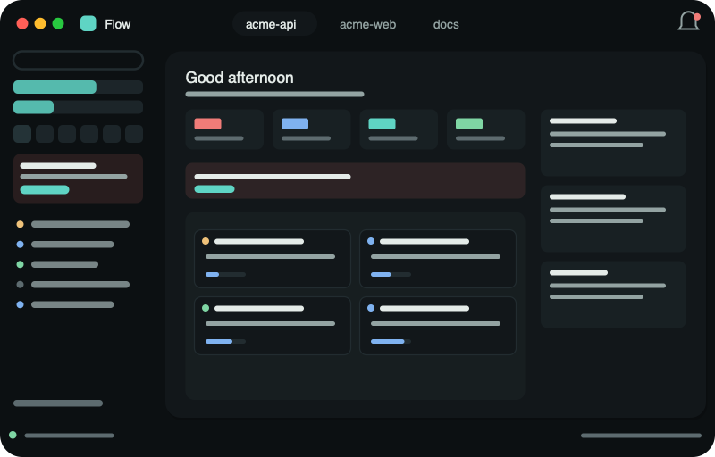

# Flow

A Herdr app layout for watching every coding agent you run and answering the ones waiting for you. It has one bar
across the top for your tabs, search and the bell, a sidebar under it with your quotas, what needs you and every agent
and space, and soft borderless cards floating on a sky, in three layouts that differ only in their look: Flow, Mist
and Daylight, each in light and dark.



Flow's mod is ported from the Herdr app mod of [cockpit](https://github.com/quaresc/cockpit) by quaresc (MIT). Flow
has its own names (the `flow` mod, the `flow` layout, `flow.*` commands), so it installs **beside**
cockpit's layout and a cockpit update never overwrites it.

## What it needs

Flow draws what cockpit's hub knows: agents, PRs, CI, tickets, runbooks, meetings and mail. Install cockpit first and
keep it installed:

```sh
curl -fsSL https://raw.githubusercontent.com/quaresc/cockpit/main/install.sh | sh
cockpit setup
```

In Claude Code, `/plugin install cockpit --marketplace quaresc/cockpit` then `/cockpit:setup` does the same. Without
cockpit, Flow's Home shows how to install it. You also need macOS (Linux should work but is untested), the Herdr app and
`jq`.

## Install

```sh
git clone https://github.com/JoseDRomano/flow-herdr.git
cd flow-herdr
sh scripts/install.sh --switch
```

The installer links this checkout's `layouts/flow*`, `mods/flow/` and `themes/flow*` into the Herdr app home
(`~/.config/herdr-app`, or `HERDR_APP_HOME`), so an edit here shows in the window within a second. It merges the
`layout:flow` section of `keys.json` into yours, and any key you bound there yourself stays
yours. `--copy` copies the files instead of linking them, and `--switch` shows the Flow layout once it's installed.
`⌘⇧L` switches layouts at any time.

`sh scripts/install.sh --uninstall` removes Flow's files and key sections and leaves cockpit's own alone.

## Layouts

- **Flow** (`flow`): one 52px bar across the window (Herdr's brand and search, your tabs as pills, the bell), the
  sidebar under it on the left, the center as borderless cards with a 16px radius, the side panel (Show, Review,
  Runbook, Files, Changes, the side browser) on the right, and the status bar across the bottom, in Geist and Geist
  Mono. Behind them is a sky: a gradient from the theme's `chrome` at the top to its `canvas` at the bottom, with no
  bands of its own for the bar, the sidebar or the status bar.

## Looks

Flow comes as three layouts with the same blocks and keys, each opening in its own look, light and dark. Switch with
`⌘⇧L`, in Settings → Look, or in Flow settings → Layout:

- **Flow** (`flow`, themes `flow` and `flow-light`): Flow's own teal.
- **Mist** (`flow-mist`, themes `flow-mist` and `flow-mist-light`): cool lavender greys and a periwinkle accent, with
  the sky lit from above. Peach marks an agent that needs you.
- **Daylight** (`flow-daylight`, themes `flow-daylight` and `flow-daylight-light`): the window's sky follows your
  agents. It's night (or a clear blue day in light) while they work, and a dawn rises from the bottom edge while one
  waits on you. Flow swaps in the dawn twins (`flow-daylight-dawn`, `flow-daylight-light-dawn`) by itself and back once
  nothing waits; the terminals keep their colours through the swap. Cards and panes are frosted glass over the sky,
  terminals included, amber is kept for what needs you, and Home opens on how many agents need you as one big numeral,
  under a greeting in Instrument Serif. Its top bar is Flow's own: the brand over the sidebar and the space's tabs in
  one pill, with Files, Changes and the bell at the right.

`layouts/flow-mist.json` and `layouts/flow-daylight.json` are written from `layouts/flow.json`, with the changes
`scripts/looks.json` gives each look, and their key sections from `layout:flow`, by `python3 scripts/looks.py`.

## Threads

A thread is a fix, a feature or a bug you're working on. Open one with `⌘N`, the **+** next to Threads in the
sidebar, or **New thread…** in the palette: pick its kind, give it a title, the machine it works on and the folder
there. Under the folder field, the dialog lists that machine's folders, from its home or the path you typed: click one
to open it and fill it in, **Up** to go back. You can also type `/full/path`, `~/path`, or a path in that machine's
home such as `src/scope`. Each thread is a Herdr space named
after it, on the machine it works on (the **main machine** unless you pick another), and you open its tabs and panes
there. Any of its panes can still split onto any other machine (see below), so one thread holds the shells of all the
machines the work touches.

A thread on another machine is a Herdr space on that machine, opened in the folder you gave. Its terminals are that
machine's own, so Herdr does there what it does for any remote space: `⌃V` or `⌘V` with an image copied puts the image
on that machine and pastes its path, so an agent there gets it, and dropped files are copied there too. In that
thread, **Split right on…** and **Split down on…** list its machine first, and a split onto it starts in the thread's
folder there. The sidebar shows the machine beside the thread's name.

The main machine is this computer unless `flow.json` in the Herdr home names another one:

```json
{ "main": "acme-dev" }
```

The sidebar lists threads in place of spaces, as cards: the kind's icon, the title, the kind, the machine it works on,
how many panes it has open and how long ago it started, then what its agents are doing (need you, working, done). A
card is one thing to click: it shows the thread, a drag moves it and a double-click renames it; the terminals inside
aren't listed. Right-click one to change its kind, rename it, mark it resolved, turn it back into a plain space (**Not a
thread**) or close it.

When the work is done, mark the thread **resolved** with the ✓ on its card (or **Mark resolved…** in its menu). It asks
once, then closes the thread's panes and their terminals and moves it to **Resolved**, folded under the threads, where a
right-click takes it off the list. Spaces that aren't threads stay under **Other spaces**, folded until you open them.

## Panes on other machines

Right-click a terminal, then **Split right on…** or **Split down on…**, or use the server button in a pane's header, to
open a pane on another machine in the same tab. Herdr runs a tab's panes on the tab's own machine, so the new pane is a
terminal there that reaches the other machine and shows its shell (a bridge pane). How it gets there depends on where
the tab lives:

- **A tab on this computer** uses `hc run --on <machine>`: every machine you added in Settings → Machines works.
- **A tab on another machine** uses that machine's own `hc`, and that knows only the machines added *there*. Without a
  route Flow asks it, and if it doesn't know the target, a toast says what to add.

Routes live in `flow.json` in the Herdr home (`~/.config/herdr-app/flow.json`), keyed by the machine to reach, then by
the machine the pane starts from (`local` is this computer, `*` any machine without a rule of its own):

```json
{
  "routes": {
    "acme-build": { "acme-dev": "ssh", "*": { "ssh": "build.acme.example", "jump": "bastion.acme.example" } },
    "acme-db": { "acme-dev": { "argv": ["fly", "ssh", "console", "-a", "acme-db"] }, "acme-web": "hc:db" },
    "local": { "acme-dev": "ssh:maya@laptop.acme.example" }
  }
}
```

| Route | Runs on the pane's machine |
| --- | --- |
| `"hc"`, `"hc:<name>"` | `hc run --on <machine>`, when that machine's hc knows it (by another name with `:<name>`) |
| `"ssh"`, `"ssh:<destination>"` | `ssh -t <destination>`, the machine's name by default (a Host of that machine's `~/.ssh/config` works) |
| `{"ssh": "<destination>", "jump": "<host>", "options": [...]}` | `ssh -t -J <host> <options> <destination>` |
| `{"argv": [...]}` | that command; `{folder}` stands for the folder to start in |

The pane starts in the same folder on the other machine when that folder exists there. Flow reads the file on each
split, so a change applies at once. A bridge pane that Herdr gave a plain shell after a restart offers
**Reconnect to <machine>** in its right-click menu, and reconnects the way it first got there.

A bridge pane is a terminal on the tab's machine, so Herdr can't put a copied image on the other machine: `⌃V` reaches
the program there, which finds no image in that machine's clipboard. To paste images into an agent on another machine,
run it in a thread on that machine.

## What stays cockpit's

- The **hub and the `cockpit` binary**. Flow reads `cockpit.json` in the Herdr home to find them, runs `cockpit`
  commands (doctor, notify, hub start) and shows cockpit's version in its settings. The sidebar's **Update** tag
  updates cockpit, which leaves Flow's files alone.
- What the **hub drives in the window by itself** still names cockpit's mod and layout. `cockpit focus <app>` from a
  shell switches the window to cockpit's layout. An agent's `show` tool opens its pane with cockpit's mod. A Start
  work that opens a chat runs cockpit's command. Notification clicks don't do any of this: Flow shows the row itself.

## Develop

```sh
node --experimental-vm-modules --test tests/*.test.mjs      # the mod's tests
for f in mods/flow/*.js; do node --input-type=module --check < "$f" || echo "$f"; done
shellcheck -S warning scripts/*.sh
python3 scripts/preview.py                                 # layouts/flow.svg and the Layout tab's pictures
```

`scripts/sandbox.sh` opens a separate Herdr window on cockpit's acme demo world with Flow in it. It needs a cockpit
checkout beside this one (`COCKPIT_REPO`, default `../cockpit-herdr`) for the demo data, and the installed `cockpit`
binary for the hub (`COCKPIT_BIN`). See the top of the script for its commands. `AGENTS.md` has the rules for working
on Flow.

MIT, see `LICENSE` and `THIRD_PARTY_NOTICES.md`.
