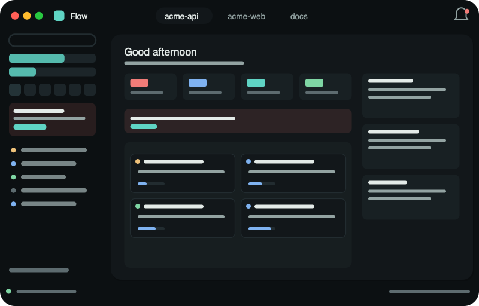

# Flow

See every coding agent you run and what it is working on, and answer the ones waiting for you without leaving what you
are doing. One bar across the top holds your tabs, search and the bell. Under it, a sidebar on the left holds your
quotas, what needs you and every agent and space. The rest is soft, borderless cards on Flow's own teal theme, in light
and dark.

Flow's mod is ported from [cockpit](https://github.com/quaresc/cockpit)'s Herdr app mod by quaresc (MIT), under names of
its own, and draws the data of cockpit's hub. Works with Claude Code, Codex and the other agents Herdr runs.

## What you see

Top to bottom, then left to right. Colors come from Flow's theme (`themes/flow.json` dark, `themes/flow-light.json`
light). Type is Geist for the UI and Geist Mono 14 for terminals.

- **Flow bar**, 52px across the window, on `chrome` (`#0c1012` dark, `#efede7` light), draggable:
  - **Brand**, 256px: Herdr's `workspace-chrome` (the Herdr mark, search, sidebar toggle), right of the window buttons
    at `[16, 18]`.
  - **Tabs**: Herdr's `tabs`, as pills.
  - **Bell**, 52px: notifications, with a dot when some are unread.
- **Body**, a row:
  - **Sidebar**, 256px (folds to a 44px rail), on `chrome`. The Flow sidebar (`{app: "sidebar"}`) fills it: "Search
    or run…", the 5h and 7d quota bars, the app icons (Home, To-do, Runbook, Meetings, …), the **Needs you**
    cards, then the spaces with what runs in each, machine by machine, in folders. Herdr's `workspace-chrome` footer
    (69px: Settings, Add machine) sits at its foot.
  - **Center**, a stack with 10px padding on the `canvas` (`#0c1012` dark). Each view is a card with a 14px radius, the
    `background` color (`#12171a` dark, `#fbfaf7` light), no border, and a medium shadow. One shows at a time:
    - **Home** (first): the greeting, the tiles, the **Next move** callout, a box per machine with its agents' cards,
      and Up next, Apps and Activity on the right. An agent opened from Home shows beside it in a 600px card.
    - **Work**: the active tab's panes as cards (14px radius, a 1px `border` that turns `accent` `#5fd4c4` on the
      focused pane, other panes veiled at 25%, a 30px Flow header on each), or the focused agent alone under its 34px
      head. The hidden **side panel**, 440px (280–900), sits on the right, a bordered card holding Show, Review,
      Runbook, Files, Changes and the side browser, with a 44px activity bar of their icons.
    - **Runbook, To-do, Meetings, Monitor, Routines, Mail**: one full card each.
- **Status bar**, 34px across the window on `chrome`: the agents by stage (each a click), the focused agent's branch
  and links, queued prompts, agents to resume, and the hub's state while it doesn't answer.
- **Queue drawer**, floating on the left edge near the bottom, a 44px peek: prompts queued for an agent, shown only
  while there are some.

## How it behaves

The views behave as cockpit's do (agent status marks, stages, answering in place, folders, the palette `⌘⇧P`, the keys
in `keys.json` under `layout:flow`). Flow differs in four ways:

- A notification's click on an app's row (to-do, runbook, meetings, monitor, routines, mail) or on an app's space
  shows it in Flow; one on a PR opens its page, as Flow has no inbox. It doesn't run `cockpit focus`, which would switch the window to cockpit's layout.
- After a cockpit update, Flow shows what changed and the new options, and offers no layout to try.
- Flow settings' Layout tab shows the Flow layout alone, and sessions cockpit drives without a terminal are listed but
  can't be opened: Flow has no chat to read them in.
- A split onto another machine (a terminal's right-click **Split right on…** / **Split down on…**) is opened from the
  tab's own machine as `flow.json`'s `routes` say: `hc run --on` from this computer by default, ssh, an ssh jump or
  any command from elsewhere (see the README). With no route from another machine, Flow asks that machine's hc, and a
  toast says what to add when it doesn't know the target.

## Built from

- **Layout** `layouts/flow.json` (preview `layouts/flow.svg`, drawn by `scripts/preview.py`): root `column`
  (`titlebar: none`, traffic lights `[16, 18]`, `canvas`, theme `{light: flow-light, dark: flow}`, Geist / Geist Mono 14,
  terminal padding `[14, 12]`, link handlers and terminal menu `flow`). It holds `flowbar` (row, 52, `chrome`:
  `brand` `workspace-chrome` 256 · `tabs` · `bell` 52), then `body` (row: `sidebar` column 256, min 44, max 480,
  `chrome`, of `flow-sidebar` and `sidebar-footer` 69; `center` stack, padding 10, active `home`), then `status` (34,
  `chrome`). `center` holds `home` (row, gap 10: `home-board` and the hidden `home-agent` 600px card), `work` (row,
  gap 10: the `view` stack of `main` (the active tab, pane cards) and `agent`, then the hidden `panel` row 440px with
  its `panel-body` stack of `show`, `review`, `runbook-panel`, `files`, `changes`, `web` and the `activity` bar 44),
  and the `runbook`, `todo`, `meetings`, `monitor`, `routines`, `mail` cards. `floating`: `queue`, edge left,
  align end, peek 44.
- **One mod** `mods/flow/` (`mod.json`: `place: none`, focusable, the URL link handler). Every block is the same mod
  with `props.app`, and so is every overlay it opens. `main.js` maps the name to a view class, `hub.js` talks to
  cockpit's hub, and `ui.js` is the design kit.
- **Themes** `themes/flow.json` and `themes/flow-light.json`, Flow's own (named like the layout, so Settings offers them
  only there). **Keys** `keys.json`, section `layout:flow`.

## Watch out

- **It needs cockpit** for everything but the shell. Without it, Home shows how to install it. Install cockpit first
  (`curl -fsSL https://raw.githubusercontent.com/quaresc/cockpit/main/install.sh | sh`, then `cockpit setup`), then
  `sh scripts/install.sh --switch`.
- **Cockpit's own files stay.** Flow installs beside cockpit's layout and mod and never touches them. Removing them
  would make cockpit's next update or `app install` switch the window to cockpit's layout as a first install does.
- **The hub still drives cockpit's mod**: `cockpit focus <app>` from a shell switches the window to cockpit's layout,
  an agent's `show` pane opens with cockpit's mod, and a Start work that opens a chat runs cockpit's command.
- **The side browser's spot** is measured from the window's right and bottom edges (`INSETS.flow` in `web.js`: the
  10px padding, the panel's border and the 44px activity bar on the right, the 34px status bar below). Keep the panel
  on the right, or change the insets with it.
- Herdr refuses imports outside a mod's folder, hence one mod for every place and every overlay. Don't split it.

## Done when

- `node --experimental-vm-modules --test tests/*.test.mjs` passes, and every module of `mods/flow/` parses.
- In the sandbox (`sh scripts/sandbox.sh start`), the window shows Flow in both themes: the bar across the top, the
  sidebar under it, Home's cards, Work with the side panel open, and every app's card from the palette.
